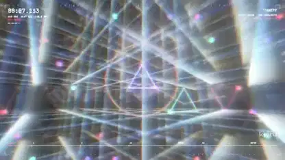

<!-- Generated by scripts/build.py. -->

# 生成式音频与 Three.js 可视化

[返回合集](https://github.com/VibeClip/awesome-fable-5-2-videos/blob/main/README.zh-CN.md)

**[▶ 完整视频](https://video.twimg.com/amplify_video/2120288036147826688/vid/avc1/1920x1080/rsVqgZfdKMOHajLt.mp4?tag=29)** · [原始发布](https://x.com/keiru_ai/status/2120288283167191402)

[keiru_ai](https://x.com/keiru_ai) · 1:30 · 2026-11-10

作者说明这段代码渲染视频使用了 Fable 5.2 与 Three.js，音频通过随机过程生成。

## 公开提示词

暂未记录公开提示词。

来源与核验信息

- 模型归属依据: 原帖明确提及该模型
- 原帖可访问性检查日期: 2026-11-13 — 原帖可访问

原帖可访问性检查不等于复现视频生成过程；生成与渲染未独立复现。

[许可证与媒体权利](https://github.com/VibeClip/awesome-fable-5-2-videos/blob/main/docs/MEDIA-RIGHTS.md)

