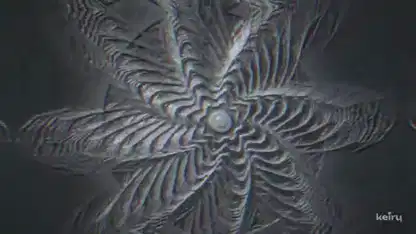

<!-- Generated by scripts/build.py. -->

# 随机种子生成的工业鼓打贝斯与浮雕画面

[返回合集](https://github.com/VibeClip/awesome-fable-5-2-videos/blob/main/README.zh-CN.md)

**[▶ 完整视频](https://video.twimg.com/amplify_video/2120532142832934912/vid/avc1/1920x1080/pRXtEmq3PKIg5qOf.mp4?tag=29)** · [原始发布](https://x.com/keiru_ai/status/2120532609625424195)

[keiru_ai](https://x.com/keiru_ai) · 1:36 · 2026-11-11

作者说明使用了 Claude Code 中的 Fable 5.2、随机种子生成音频和 Three.js 场景。

## 公开提示词

暂未记录公开提示词。

来源与核验信息

- 模型归属依据: 原帖明确提及该模型
- 原帖可访问性检查日期: 2026-11-13 — 原帖可访问

原帖可访问性检查不等于复现视频生成过程；生成与渲染未独立复现。

[许可证与媒体权利](https://github.com/VibeClip/awesome-fable-5-2-videos/blob/main/docs/MEDIA-RIGHTS.md)

