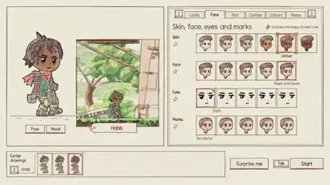

<!-- Generated by scripts/build.py. -->

# 《Valsera》用代码绘制的横版角色扮演游戏

[返回合集](https://github.com/VibeClip/awesome-fable-5-2-videos/blob/main/README.zh-CN.md)

**[▶ 完整视频](https://video.twimg.com/amplify_video/2121679674543890432/vid/avc1/1920x1080/BOfROoc3Hogm0aWs.mp4?tag=29)** · [原始发布](https://x.com/kevin_t_ngo/status/2121701020598415465)

[kevin_t_ngo](https://x.com/kevin_t_ngo) · 1:45 · 2026-11-14

作者称视觉由 Fable 5.2 用代码绘制，未使用图像模型或预制美术素材。演示展示了角色设定、村镇和战斗，作者在回复里附上试玩入口。

[原始发布](https://x.com/kevin_t_ngo/status/2121701022087475398)

## 公开提示词

暂未记录公开提示词。

来源与核验信息

- 模型归属依据: 原帖明确提及该模型
- 原帖可访问性检查日期: 2026-11-14 — 原帖可访问

原帖可访问性检查不等于复现视频生成过程；生成与渲染未独立复现。

[许可证与媒体权利](https://github.com/VibeClip/awesome-fable-5-2-videos/blob/main/docs/MEDIA-RIGHTS.md)

