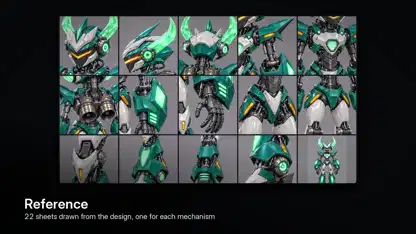

<!-- Generated by scripts/build.py. -->

# Blender 机甲角色

[返回合集](https://github.com/VibeClip/awesome-fable-5-2-videos/blob/main/README.zh-CN.md)

**[▶ 完整视频](https://video.twimg.com/amplify_video/2123090716650065920/vid/avc1/1920x1080/XPzaGc3H-7uUSVhn.mp4?tag=29)** · [原始发布](https://x.com/kevin_t_ngo/status/2123091419883831775)

[kevin_t_ngo](https://x.com/kevin_t_ngo) · 0:35 · 2026-11-18

作者注明使用 Fable 5.2 和 AnyMachine，GPT Image 2.6 生成部件参考图，再用 Blender 脚本制作。

## 公开提示词

暂未记录公开提示词。

来源与核验信息

- 模型归属依据: 原帖明确提及该模型
- 原帖可访问性检查日期: 2026-11-22 — 原帖可访问

原帖可访问性检查不等于复现视频生成过程；生成与渲染未独立复现。

[许可证与媒体权利](https://github.com/VibeClip/awesome-fable-5-2-videos/blob/main/docs/MEDIA-RIGHTS.md)

