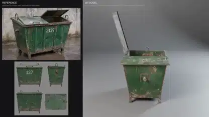

<!-- Generated by scripts/build.py. -->

# 从参考图建出的旧绿色垃圾箱

[返回合集](https://github.com/VibeClip/awesome-fable-5-2-videos/blob/main/README.zh-CN.md)

**[▶ 完整视频](https://video.twimg.com/amplify_video/2120621064535371777/vid/avc1/1920x1080/-rlY-W50HSgt74Yz.mp4?tag=29)** · [原始发布](https://x.com/KHvostikk/status/2120621109125202344)

[KHvostikk](https://x.com/KHvostikk) · 0:12 · 2026-11-11

作者披露使用 Fable 5.2，并提到 Codex 图像参考和 PBR 贴图。演示把参考图与旋转模型并排放置，便于观察掉漆和箱盖。

## 公开提示词

暂未记录公开提示词。

来源与核验信息

- 模型归属依据: 原帖明确提及该模型
- 原帖可访问性检查日期: 2026-11-15 — 原帖可访问

原帖可访问性检查不等于复现视频生成过程；生成与渲染未独立复现。

[许可证与媒体权利](https://github.com/VibeClip/awesome-fable-5-2-videos/blob/main/docs/MEDIA-RIGHTS.md)

