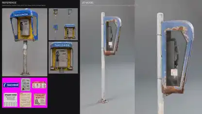

<!-- Generated by scripts/build.py. -->

# 从参考图建出的公用电话

[返回合集](https://github.com/VibeClip/awesome-fable-5-2-videos/blob/main/README.zh-CN.md)

**[▶ 完整视频](https://video.twimg.com/amplify_video/2120635020545064960/vid/avc1/1920x1080/gTXdQtNaUG2UIDja.mp4?tag=29)** · [原始发布](https://x.com/KHvostikk/status/2120635318001180996)

[KHvostikk](https://x.com/KHvostikk) · 0:12 · 2026-11-11

作者将其描述为使用 Fable 5.2 的图像转 3D 测试。视频把参考图和公用电话的旋转渲染并排展示。原帖未注明其他工具。

## 公开提示词

暂未记录公开提示词。

来源与核验信息

- 模型归属依据: 原帖明确提及该模型
- 原帖可访问性检查日期: 2026-11-14 — 原帖可访问

原帖可访问性检查不等于复现视频生成过程；生成与渲染未独立复现。

[许可证与媒体权利](https://github.com/VibeClip/awesome-fable-5-2-videos/blob/main/docs/MEDIA-RIGHTS.md)

