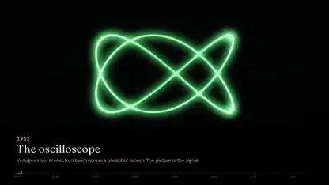

<!-- Generated by scripts/build.py. -->

# 计算机图形学的动态时间线

[返回合集](https://github.com/VibeClip/awesome-fable-5-2-videos/blob/main/README.zh-CN.md)

**[▶ 完整视频](https://video.twimg.com/amplify_video/2120642800303943680/vid/avc1/1920x1080/3NQuavTtjgfD_64R.mp4?tag=29)** · [原始发布](https://x.com/kloss_xyz/status/2120644881790255276)

[kloss_xyz](https://x.com/kloss_xyz) · 1:50 · 2026-11-11

作者公开了一句给 Fable 5.2 的提示词。短片用示波器轨迹、反光球和路径追踪房间演示不同时期的图形技术。

## 公开提示词

保留作者分享时的原始语言。使用时请查看原帖上下文及所需素材。

> Animate the history of computer graphics and render it in a 1080p 16:9 video.

[查看作者公开提示词](https://x.com/kloss_xyz/status/2120644881790255276)

来源与核验信息

- 模型归属依据: 原帖明确提及该模型
- 原帖可访问性检查日期: 2026-11-14 — 原帖可访问

原帖可访问性检查不等于复现视频生成过程；生成与渲染未独立复现。

[许可证与媒体权利](https://github.com/VibeClip/awesome-fable-5-2-videos/blob/main/docs/MEDIA-RIGHTS.md)

