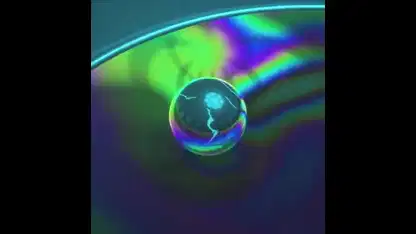

<!-- Generated by scripts/build.py. -->

# 单个 GLSL 着色器里的虹彩玻璃

[返回合集](https://github.com/VibeClip/awesome-fable-5-2-videos/blob/main/README.zh-CN.md)

**[▶ 完整视频](https://video.twimg.com/amplify_video/2120689574079078400/vid/avc1/1080x1080/GQ2VNJwrUh4fKSoc.mp4?tag=29)** · [原始发布](https://x.com/kloss_xyz/status/2120689622124798324)

[kloss_xyz](https://x.com/kloss_xyz) · 0:30 · 2026-11-12

作者用 Python 制作动画、用单个 GLSL 着色器渲染，音频使用采样库录音并在 Python 中混音。

[原始发布](https://x.com/kloss_xyz/status/2120691788700910046)

## 公开提示词

作者在下方链接分享了提示词，请结合原始上下文、参考素材和后续指令阅读。

[查看作者公开提示词](https://x.com/kloss_xyz/status/2120691788700910046)

来源与核验信息

- 模型归属依据: 原帖明确提及该模型
- 原帖可访问性检查日期: 2026-11-16 — 原帖可访问

原帖可访问性检查不等于复现视频生成过程；生成与渲染未独立复现。

[许可证与媒体权利](https://github.com/VibeClip/awesome-fable-5-2-videos/blob/main/docs/MEDIA-RIGHTS.md)

