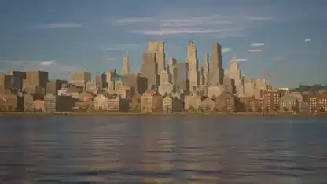

<!-- Generated by scripts/build.py. -->

# 从白天到夜晚的 Three.js 小城

[返回合集](https://github.com/VibeClip/awesome-fable-5-2-videos/blob/main/README.zh-CN.md)

**[▶ 完整视频](https://video.twimg.com/amplify_video/2121736588514197504/vid/avc1/3840x2160/1Rcr08kUxI-Q3eMQ.mp4?tag=29)** · [原始发布](https://x.com/LexnLin/status/2121737343287828694)

[LexnLin](https://x.com/LexnLin) · 1:00 · 2026-11-14

作者说明画面由 Fable 5.2 用 Three.js 写代码制作，音频单独处理。

## 公开提示词

暂未记录公开提示词。

来源与核验信息

- 模型归属依据: 原帖明确提及该模型
- 原帖可访问性检查日期: 2026-11-16 — 原帖可访问

原帖可访问性检查不等于复现视频生成过程；生成与渲染未独立复现。

[许可证与媒体权利](https://github.com/VibeClip/awesome-fable-5-2-videos/blob/main/docs/MEDIA-RIGHTS.md)

