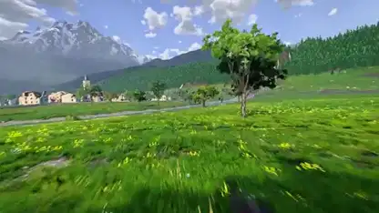

<!-- Generated by scripts/build.py. -->

# Valle Morta：高山生存游戏

[返回合集](https://github.com/VibeClip/awesome-fable-5-2-videos/blob/main/README.zh-CN.md)

**[▶ 完整视频](https://video.twimg.com/amplify_video/2121932247418781696/vid/avc1/3840x2160/pD4ekVQZGGrOVgAh.mp4?tag=29)** · [原始发布](https://x.com/LexnLin/status/2121934071429468543)

[LexnLin](https://x.com/LexnLin) · 0:45 · 2026-11-15

开发者以 Fable 5.2 为主，用 Opus 5.5 和 Sonnet 作子代理，以 Three.js 构建游戏并用 Blender 制作部分模型。配乐及部分音效来自第三方。

[原始发布](https://x.com/LexnLin/status/2121934075229303036)

[原始发布](https://x.com/LexnLin/status/2121934078408597998)

[原始发布](https://x.com/LexnLin/status/2122012749664325903)

## 公开提示词

暂未记录公开提示词。

来源与核验信息

- 模型归属依据: 原帖明确提及该模型
- 原帖可访问性检查日期: 2026-11-16 — 原帖可访问

原帖可访问性检查不等于复现视频生成过程；生成与渲染未独立复现。

[许可证与媒体权利](https://github.com/VibeClip/awesome-fable-5-2-videos/blob/main/docs/MEDIA-RIGHTS.md)

