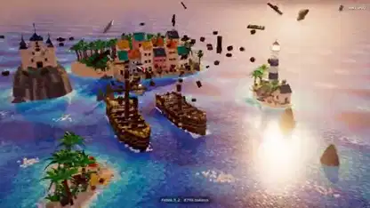

<!-- Generated by scripts/build.py. -->

# 连海浪也由积木组成的海盗短片

[返回合集](https://github.com/VibeClip/awesome-fable-5-2-videos/blob/main/README.zh-CN.md)

**[▶ 完整视频](https://video.twimg.com/amplify_video/2121066008483913728/vid/avc1/1920x1080/kzRTU-ZlEwqnem5b.mp4?tag=29)** · [原始发布](https://x.com/loktar00/status/2121066943662743624)

[loktar00](https://x.com/loktar00) · 0:50 · 2026-11-13

作者将海盗动画归功于 Fable 5.2，并说明每道浪都由单独运动的积木组成。

## 公开提示词

暂未记录公开提示词。

来源与核验信息

- 模型归属依据: 原帖明确提及该模型
- 原帖可访问性检查日期: 2026-11-13 — 原帖可访问

原帖可访问性检查不等于复现视频生成过程；生成与渲染未独立复现。

[许可证与媒体权利](https://github.com/VibeClip/awesome-fable-5-2-videos/blob/main/docs/MEDIA-RIGHTS.md)

