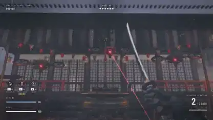

<!-- Generated by scripts/build.py. -->

# 樱花谷里的浏览器动作游戏

[返回合集](https://github.com/VibeClip/awesome-fable-5-2-videos/blob/main/README.zh-CN.md)

**[▶ 完整视频](https://video.twimg.com/amplify_video/2121119476183949312/vid/avc1/3840x2160/1B5Se8KJ2Uf3V53F.mp4?tag=29)** · [原始发布](https://x.com/MengTo/status/2121139143615074501)

[MengTo](https://x.com/MengTo) · 0:52 · 2026-11-13

作者将自己已有的场景作为基础，使用 Fable 5.2 和 Three.js 制作游戏。第一人称镜头穿过灯笼照亮的建筑、道路和远处的塔楼。

## 公开提示词

暂未记录公开提示词。

来源与核验信息

- 模型归属依据: 原帖明确提及该模型
- 原帖可访问性检查日期: 2026-11-15 — 原帖可访问

原帖可访问性检查不等于复现视频生成过程；生成与渲染未独立复现。

[许可证与媒体权利](https://github.com/VibeClip/awesome-fable-5-2-videos/blob/main/docs/MEDIA-RIGHTS.md)

