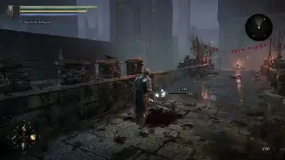

<!-- Generated by scripts/build.py. -->

# Three.js 制作的黑暗奇幻浏览器游戏

[返回合集](https://github.com/VibeClip/awesome-fable-5-2-videos/blob/main/README.zh-CN.md)

**[▶ 完整视频](https://video.twimg.com/ext_tw_video/2121896455816548352/pu/vid/avc1/1280x720/RU6LuiJL3vKv0LKs.mp4?tag=12)** · [原始发布](https://x.com/MengTo/status/2121896633848017145)

[MengTo](https://x.com/MengTo) · 1:39 · 2026-11-15

作者披露在 Claude Code 中使用 Fable 5.2 和 Opus 5.5，素材使用 Seedream 5.0 Pro 与 Tripo。实机画面展示地图、环境光效和首领关卡。

[原始发布](https://x.com/MengTo/status/2121896684653576574)

## 公开提示词

作者在下方链接分享了提示词，请结合原始上下文、参考素材和后续指令阅读。

[查看作者公开提示词](https://x.com/MengTo/status/2121896842300686560)

来源与核验信息

- 模型归属依据: 原帖明确提及该模型
- 原帖可访问性检查日期: 2026-11-15 — 原帖可访问

原帖可访问性检查不等于复现视频生成过程；生成与渲染未独立复现。

[许可证与媒体权利](https://github.com/VibeClip/awesome-fable-5-2-videos/blob/main/docs/MEDIA-RIGHTS.md)

