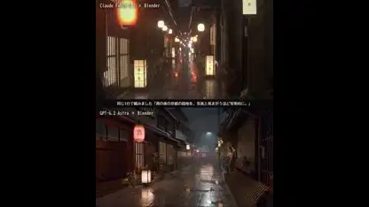

<!-- Generated by scripts/build.py. -->

# Blender 京都雨夜小巷对比

[返回合集](https://github.com/VibeClip/awesome-fable-5-2-videos/blob/main/README.zh-CN.md)

**[▶ 完整视频](https://video.twimg.com/amplify_video/2123403402856353792/vid/avc1/480x562/eBUiSAw1Wp3mANi0.mp4?tag=29)** · [原始发布](https://x.com/mizugame_22/status/2123403431167844544)

[mizugame_22](https://x.com/mizugame_22) · 0:13 · 2026-11-19

上方为 Fable 5.2，下方为 GPT-6.2 Astra。两者均使用 Blender Cycles、CC0 外部素材和另一个 AI 的评审。原帖上下排列两版开头约 13 秒。

## 公开提示词

保留作者分享时的原始语言。使用时请查看原帖上下文及所需素材。

> 雨の夜の京都の路地を、写真と見まがうほど写実的に。

[查看作者公开提示词](https://x.com/mizugame_22/status/2123403431167844544)

来源与核验信息

- 模型归属依据: 原帖明确提及该模型
- 原帖可访问性检查日期: 2026-11-24 — 原帖可访问

原帖可访问性检查不等于复现视频生成过程；生成与渲染未独立复现。

[许可证与媒体权利](https://github.com/VibeClip/awesome-fable-5-2-videos/blob/main/docs/MEDIA-RIGHTS.md)

