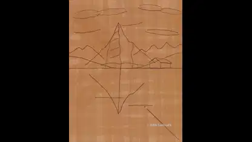

<!-- Generated by scripts/build.py. -->

# 从草图到倒影的瑞士湖景绘画

[返回合集](https://github.com/VibeClip/awesome-fable-5-2-videos/blob/main/README.zh-CN.md)

**[▶ 完整视频](https://video.twimg.com/amplify_video/2120473115025088512/vid/avc1/1080x1350/smQxijj1Yis_3zAa.mp4?tag=29)** · [原始发布](https://x.com/MrTacticalX/status/2120473175158849884)

[MrTacticalX](https://x.com/MrTacticalX) · 1:00 · 2026-11-11

作者将作品归功于 Fable 5.2，并称其为瑞士湖景油画。原帖未说明渲染工具。

## 公开提示词

暂未记录公开提示词。

来源与核验信息

- 模型归属依据: 原帖明确提及该模型
- 原帖可访问性检查日期: 2026-11-13 — 原帖可访问

原帖可访问性检查不等于复现视频生成过程；生成与渲染未独立复现。

[许可证与媒体权利](https://github.com/VibeClip/awesome-fable-5-2-videos/blob/main/docs/MEDIA-RIGHTS.md)

