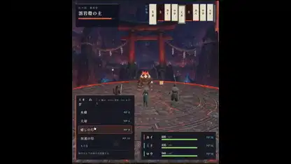

<!-- Generated by scripts/build.py. -->

# 能看到行动顺序的浏览器回合制战斗

[返回合集](https://github.com/VibeClip/awesome-fable-5-2-videos/blob/main/README.zh-CN.md)

**[▶ 完整视频](https://video.twimg.com/amplify_video/2120850004445470720/vid/avc1/1492x1660/RnGC-9muW2GDFzf5.mp4?tag=29)** · [原始发布](https://x.com/nesaivideo/status/2120851458421821675)

[nesaivideo](https://x.com/nesaivideo) · 3:13 · 2026-11-12

作者称浏览器演示由 Fable 5.2 制作，涵盖 4 个 3D 角色、场景和可见的行动顺序。录像展现战斗及操作界面。

## 公开提示词

暂未记录公开提示词。

来源与核验信息

- 模型归属依据: 原帖明确提及该模型
- 原帖可访问性检查日期: 2026-11-15 — 原帖可访问

原帖可访问性检查不等于复现视频生成过程；生成与渲染未独立复现。

[许可证与媒体权利](https://github.com/VibeClip/awesome-fable-5-2-videos/blob/main/docs/MEDIA-RIGHTS.md)

