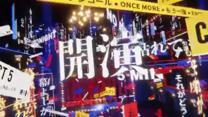

<!-- Generated by scripts/build.py. -->

# 霓虹街景里的动态文字

[返回合集](https://github.com/VibeClip/awesome-fable-5-2-videos/blob/main/README.zh-CN.md)

**[▶ 完整视频](https://video.twimg.com/amplify_video/2121589637651243009/vid/avc1/1920x1080/Lo94U7utGuyrBcek.mp4?tag=29)** · [原始发布](https://x.com/noel_ai_lab/status/2121589715363303843)

[noel_ai_lab](https://x.com/noel_ai_lab) · 0:29 · 2026-11-14

作者披露画面由 Fable 5.2 制作，音乐来自 Suno。短片把日文大字和街头招牌融入快速变化的透视画面。

## 公开提示词

暂未记录公开提示词。

来源与核验信息

- 模型归属依据: 原帖明确提及该模型
- 原帖可访问性检查日期: 2026-11-14 — 原帖可访问

原帖可访问性检查不等于复现视频生成过程；生成与渲染未独立复现。

[许可证与媒体权利](https://github.com/VibeClip/awesome-fable-5-2-videos/blob/main/docs/MEDIA-RIGHTS.md)

