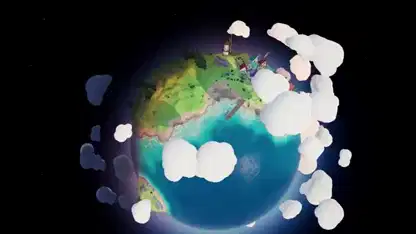

<!-- Generated by scripts/build.py. -->

# 在小小星球上散步

[返回合集](https://github.com/VibeClip/awesome-fable-5-2-videos/blob/main/README.zh-CN.md)

**[▶ 完整视频](https://video.twimg.com/amplify_video/2120187200919027712/vid/avc1/1920x1080/6x9gOegXbLLMQegl.mp4?tag=29)** · [原始发布](https://x.com/prasenx/status/2120188077855613174)

[prasenx](https://x.com/prasenx) · 0:39 · 2026-11-10

作者说互动星球及预告片由 Fable 5.2 制作，未披露渲染器。

## 公开提示词

暂未记录公开提示词。

来源与核验信息

- 模型归属依据: 原帖明确提及该模型
- 原帖可访问性检查日期: 2026-11-16 — 原帖可访问

原帖可访问性检查不等于复现视频生成过程；生成与渲染未独立复现。

[许可证与媒体权利](https://github.com/VibeClip/awesome-fable-5-2-videos/blob/main/docs/MEDIA-RIGHTS.md)

