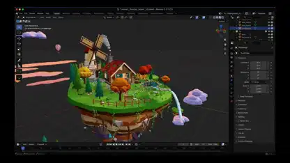

<!-- Generated by scripts/build.py. -->

# 在 Blender 中搭建浮岛

[返回合集](https://github.com/VibeClip/awesome-fable-5-2-videos/blob/main/README.zh-CN.md)

**[▶ 完整视频](https://video.twimg.com/amplify_video/2120498596738904064/vid/avc1/1920x984/gIo26aM7PmpiuAib.mp4?tag=29)** · [原始发布](https://x.com/rewind02/status/2120498751773057186)

[rewind02](https://x.com/rewind02) · 0:30 · 2026-11-11

作者说明，Fable 5.2 通过 Blender MCP 以 Python 制作物体、材质与灯光，并对比了两种推理强度。

## 公开提示词

保留作者分享时的原始语言。使用时请查看原帖上下文及所需素材。

> create a low poly floating island scene in blender using blender mcp

[查看作者公开提示词](https://x.com/rewind02/status/2120498751773057186)

来源与核验信息

- 模型归属依据: 原帖明确提及该模型
- 原帖可访问性检查日期: 2026-11-16 — 原帖可访问

原帖可访问性检查不等于复现视频生成过程；生成与渲染未独立复现。

[许可证与媒体权利](https://github.com/VibeClip/awesome-fable-5-2-videos/blob/main/docs/MEDIA-RIGHTS.md)

