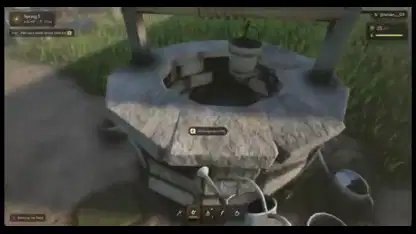

<!-- Generated by scripts/build.py. -->

# 带天气变化的单文件 3D 农场游戏

[返回合集](https://github.com/VibeClip/awesome-fable-5-2-videos/blob/main/README.zh-CN.md)

**[▶ 完整视频](https://video.twimg.com/amplify_video/2120582673261318144/vid/avc1/1920x1010/Oy1nF66fVaGSdKpJ.mp4?tag=29)** · [原始发布](https://x.com/rewind02/status/2120582812793475290)

[rewind02](https://x.com/rewind02) · 2:04 · 2026-11-11

作者披露用 Fable 5.2 和 Three.js 制作农场游戏。录像展示白天、雾中和夜晚的农具与地形，场景及贴图用代码生成。

## 公开提示词

暂未记录公开提示词。

来源与核验信息

- 模型归属依据: 原帖明确提及该模型
- 原帖可访问性检查日期: 2026-11-15 — 原帖可访问

原帖可访问性检查不等于复现视频生成过程；生成与渲染未独立复现。

[许可证与媒体权利](https://github.com/VibeClip/awesome-fable-5-2-videos/blob/main/docs/MEDIA-RIGHTS.md)

