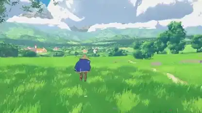

<!-- Generated by scripts/build.py. -->

# 手绘风山谷与披斗篷的旅人

[返回合集](https://github.com/VibeClip/awesome-fable-5-2-videos/blob/main/README.zh-CN.md)

**[▶ 完整视频](https://video.twimg.com/amplify_video/2121215994832068608/vid/avc1/1920x1080/Si-UOwjUQwtBMraT.mp4?tag=29)** · [原始发布](https://x.com/rewind02/status/2121216070375612527)

[rewind02](https://x.com/rewind02) · 0:23 · 2026-11-13

作者披露使用 Fable 5.2、Three.js 和 Rapier 实现漫游。地形基于高度图构建，旅人角色在 Blender 中制作并添加动画。

## 公开提示词

暂未记录公开提示词。

来源与核验信息

- 模型归属依据: 原帖明确提及该模型
- 原帖可访问性检查日期: 2026-11-15 — 原帖可访问

原帖可访问性检查不等于复现视频生成过程；生成与渲染未独立复现。

[许可证与媒体权利](https://github.com/VibeClip/awesome-fable-5-2-videos/blob/main/docs/MEDIA-RIGHTS.md)

