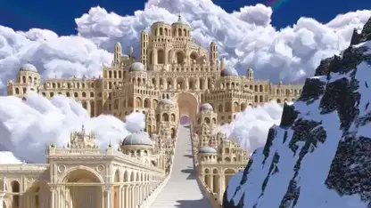

<!-- Generated by scripts/build.py. -->

# 《Ivory Kingdom》雪峰间的白色宫殿

[返回合集](https://github.com/VibeClip/awesome-fable-5-2-videos/blob/main/README.zh-CN.md)

**[▶ 完整视频](https://video.twimg.com/amplify_video/2121386923503611904/vid/avc1/3840x2160/Xwr5UsmN7kwaB5iI.mp4?tag=29)** · [原始发布](https://x.com/scottstts/status/2121626206613491787)

[scottstts](https://x.com/scottstts) · 2:00 · 2026-11-14

作者称 Fable 5.2 用 Three.js 程序化构建整个场景。镜头从雪峰和宫殿露台的远景进入内部走廊。

[原始发布](https://x.com/scottstts/status/2121626207334838473)

## 公开提示词

暂未记录公开提示词。

来源与核验信息

- 模型归属依据: 原帖明确提及该模型
- 原帖可访问性检查日期: 2026-11-14 — 原帖可访问

原帖可访问性检查不等于复现视频生成过程；生成与渲染未独立复现。

[许可证与媒体权利](https://github.com/VibeClip/awesome-fable-5-2-videos/blob/main/docs/MEDIA-RIGHTS.md)

