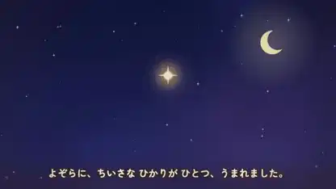

<!-- Generated by scripts/build.py. -->

# 给孩子讲生命可贵的插画短片

[返回合集](https://github.com/VibeClip/awesome-fable-5-2-videos/blob/main/README.zh-CN.md)

**[▶ 完整视频](https://video.twimg.com/amplify_video/2121449186055073792/vid/avc1/1280x720/AGilyHy2M2HMhJpS.mp4?tag=29)** · [原始发布](https://x.com/shiomasvision/status/2121449322453860803)

[shiomasvision](https://x.com/shiomasvision) · 1:29 · 2026-11-14

作者用 Claude Code 与 Fable 5.2 制作一支面向幼儿的故事短片。画面从月夜转入家庭场景，用柔和色彩和字幕串联。作者在回复里说明创作要求。

[原始发布](https://x.com/shiomasvision/status/2121449510316749105)

## 公开提示词

保留作者分享时的原始语言。使用时请查看原帖上下文及所需素材。

> 5歳くらいの子どもに、命の大切さが自然に伝わる、心が温まる動画を作って

[查看作者公开提示词](https://x.com/shiomasvision/status/2121449510316749105)

来源与核验信息

- 模型归属依据: 原帖明确提及该模型
- 原帖可访问性检查日期: 2026-11-15 — 原帖可访问

原帖可访问性检查不等于复现视频生成过程；生成与渲染未独立复现。

[许可证与媒体权利](https://github.com/VibeClip/awesome-fable-5-2-videos/blob/main/docs/MEDIA-RIGHTS.md)

