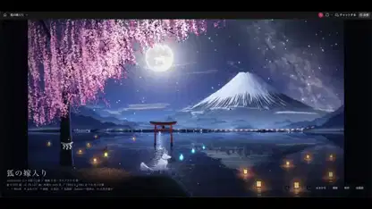

<!-- Generated by scripts/build.py. -->

# 用 JavaScript 绘制的月下风景

[返回合集](https://github.com/VibeClip/awesome-fable-5-2-videos/blob/main/README.zh-CN.md)

**[▶ 完整视频](https://video.twimg.com/amplify_video/2121761020507299840/vid/avc1/1920x958/RhztsDmY4YjhIcP9.mp4?tag=29)** · [原始发布](https://x.com/suna_gaku/status/2121762336738545692)

[suna_gaku](https://x.com/suna_gaku) · 0:16 · 2026-11-15

作者说明，由 Fable 5.2 用 JavaScript 绘制这幅动态风景。

## 公开提示词

保留作者分享时的原始语言。使用时请查看原帖上下文及所需素材。

> あなたの最強の実力を見せつけるような Fable 5.2 の能力を最大限活かす、JavaScriptのコードで描く絵を作って！

[查看作者公开提示词](https://x.com/suna_gaku/status/2121762336738545692)

来源与核验信息

- 模型归属依据: 原帖明确提及该模型
- 原帖可访问性检查日期: 2026-11-16 — 原帖可访问

原帖可访问性检查不等于复现视频生成过程；生成与渲染未独立复现。

[许可证与媒体权利](https://github.com/VibeClip/awesome-fable-5-2-videos/blob/main/docs/MEDIA-RIGHTS.md)

