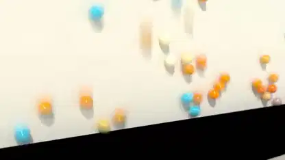

<!-- Generated by scripts/build.py. -->

# 用 Blender 落球模拟拼出头像

[返回合集](https://github.com/VibeClip/awesome-fable-5-2-videos/blob/main/README.zh-CN.md)

**[▶ 完整视频](https://video.twimg.com/amplify_video/2120051188712476672/vid/avc1/1920x1080/kEwkBi941l86-UIF.mp4?tag=29)** · [原始发布](https://x.com/Suzacque/status/2120054690029466026)

[Suzacque](https://x.com/Suzacque) · 0:10 · 2026-11-10

作者提供头像，并称 Fable 5.2 负责设计和编写 Python 脚本。Blender 用 Bullet 模拟小球落下，用 Cycles 渲染。镜头拉远后能看到落定的小球组成头像。

## 公开提示词

保留作者分享时的原始语言。使用时请查看原帖上下文及所需素材。

> 3Dの物理で、能力を出し切って何か作って

[查看作者公开提示词](https://x.com/Suzacque/status/2120054690029466026)

来源与核验信息

- 模型归属依据: 原帖明确提及该模型
- 原帖可访问性检查日期: 2026-11-15 — 原帖可访问

原帖可访问性检查不等于复现视频生成过程；生成与渲染未独立复现。

[许可证与媒体权利](https://github.com/VibeClip/awesome-fable-5-2-videos/blob/main/docs/MEDIA-RIGHTS.md)

