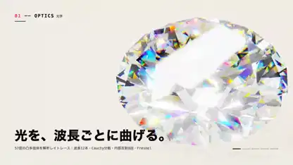

<!-- Generated by scripts/build.py. -->

# 《光与波》从宝石折射到波形干涉

[返回合集](https://github.com/VibeClip/awesome-fable-5-2-videos/blob/main/README.zh-CN.md)

**[▶ 完整视频](https://video.twimg.com/amplify_video/2120292139250962433/vid/avc1/1280x720/4Eq6Y8beUzyI6wnM.mp4?tag=14)** · [原始发布](https://x.com/taka_claudecode/status/2120292244737683687)

[taka_claudecode](https://x.com/taka_claudecode) · 0:38 · 2026-11-10

作者称画面和音乐都由 Fable 5.2 编写。几段动画分别展示宝石色散、类似黏菌的生长路径以及随波运动的粒子。

## 公开提示词

暂未记录公开提示词。

来源与核验信息

- 模型归属依据: 原帖明确提及该模型
- 原帖可访问性检查日期: 2026-11-14 — 原帖可访问

原帖可访问性检查不等于复现视频生成过程；生成与渲染未独立复现。

[许可证与媒体权利](https://github.com/VibeClip/awesome-fable-5-2-videos/blob/main/docs/MEDIA-RIGHTS.md)

