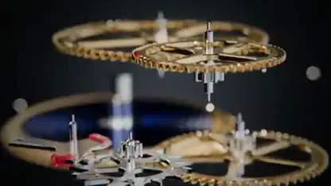

<!-- Generated by scripts/build.py. -->

# 机械表机芯的爆炸分解动画

[返回合集](https://github.com/VibeClip/awesome-fable-5-2-videos/blob/main/README.zh-CN.md)

**[▶ 完整视频](https://video.twimg.com/amplify_video/2119911154638376960/vid/avc1/1920x1080/W-EtG3d_QCeqJjGK.mp4?tag=29)** · [原始发布](https://x.com/techfren/status/2119911343633682916)

[techfren](https://x.com/techfren) · 0:42 · 2026-11-09

作者称 Fable 5.2 用代码构建了机芯。齿轮与夹板逐层分离，镜头随后回到组装后的手表。原帖未披露渲染工具。

## 公开提示词

暂未记录公开提示词。

来源与核验信息

- 模型归属依据: 原帖明确提及该模型
- 原帖可访问性检查日期: 2026-11-14 — 原帖可访问

原帖可访问性检查不等于复现视频生成过程；生成与渲染未独立复现。

[许可证与媒体权利](https://github.com/VibeClip/awesome-fable-5-2-videos/blob/main/docs/MEDIA-RIGHTS.md)

