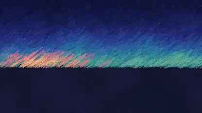

<!-- Generated by scripts/build.py. -->

# 一笔一笔画出的极光

[返回合集](https://github.com/VibeClip/awesome-fable-5-2-videos/blob/main/README.zh-CN.md)

**[▶ 完整视频](https://video.twimg.com/amplify_video/2121810479509274624/vid/avc1/1280x720/ZXhjmQqQuup48IsG.mp4?tag=14)** · [原始发布](https://x.com/Terry_Djony/status/2121953865730027622)

[Terry_Djony](https://x.com/Terry_Djony) · 0:28 · 2026-11-15

作者说极光的粉彩与彩铅笔触由 Fable 5.2 写出的代码实时绘制。

## 公开提示词

暂未记录公开提示词。

来源与核验信息

- 模型归属依据: 原帖明确提及该模型
- 原帖可访问性检查日期: 2026-11-16 — 原帖可访问

原帖可访问性检查不等于复现视频生成过程；生成与渲染未独立复现。

[许可证与媒体权利](https://github.com/VibeClip/awesome-fable-5-2-videos/blob/main/docs/MEDIA-RIGHTS.md)

