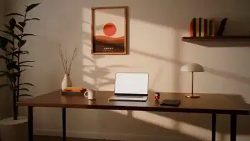

<!-- Generated by scripts/build.py. -->

# 《直到黎明》用 Blender 渲染的桌边故事

[返回合集](https://github.com/VibeClip/awesome-fable-5-2-videos/blob/main/README.zh-CN.md)

**[▶ 完整视频](https://video.twimg.com/amplify_video/2120640502261575680/vid/avc1/1280x720/k2KorEXRvxHQV80s.mp4?tag=29)** · [原始发布](https://x.com/toumorocorn_00/status/2120640549543936475)

[toumorocorn_00](https://x.com/toumorocorn_00) · 0:59 · 2026-11-11

作者受《The Edge》启发另做一支短片，加入自己的吉祥物与配乐。Fable 5.2 用 Blender 脚本构建房间、桌面和人偶，音乐来自 muse 与 Suno。

## 公开提示词

暂未记录公开提示词。

来源与核验信息

- 模型归属依据: 原帖明确提及该模型
- 原帖可访问性检查日期: 2026-11-14 — 原帖可访问

原帖可访问性检查不等于复现视频生成过程；生成与渲染未独立复现。

[许可证与媒体权利](https://github.com/VibeClip/awesome-fable-5-2-videos/blob/main/docs/MEDIA-RIGHTS.md)

