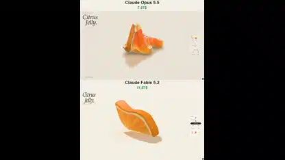

<!-- Generated by scripts/build.py. -->

# 两款模型制作可交互的橙瓣果冻

[返回合集](https://github.com/VibeClip/awesome-fable-5-2-videos/blob/main/README.zh-CN.md)

**[▶ 完整视频](https://video.twimg.com/amplify_video/2121646347770015745/vid/avc1/1080x1400/oYsA5ldV906FI0dm.mp4?tag=29)** · [原始发布](https://x.com/vib3coded/status/2121646685319221546)

[vib3coded](https://x.com/vib3coded) · 0:17 · 2026-11-14

作者用同一提示词对比 Fable 5.2 与 Opus 5.5，录像展示两片果冻受力后的不同变形。公开提示词指定 WebGPU 和 WGSL。

## 公开提示词

作者在下方链接分享了提示词，请结合原始上下文、参考素材和后续指令阅读。

[查看作者公开提示词](https://x.com/vib3coded/status/2121646834611331214)

来源与核验信息

- 模型归属依据: 原帖明确提及该模型
- 原帖可访问性检查日期: 2026-11-14 — 原帖可访问

原帖可访问性检查不等于复现视频生成过程；生成与渲染未独立复现。

[许可证与媒体权利](https://github.com/VibeClip/awesome-fable-5-2-videos/blob/main/docs/MEDIA-RIGHTS.md)

