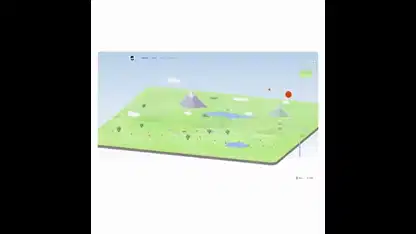

<!-- Generated by scripts/build.py. -->

# 把作品集页眉变成可互动的迷你岛

[返回合集](https://github.com/VibeClip/awesome-fable-5-2-videos/blob/main/README.zh-CN.md)

**[▶ 完整视频](https://video.twimg.com/amplify_video/2120683743199301632/vid/avc1/1080x1080/ezd_CzSHH4_ZktKm.mp4?tag=29)** · [原始发布](https://x.com/willbepan/status/2120683775499575626)

[willbepan](https://x.com/willbepan) · 0:20 · 2026-11-12

作者称 Fable 5.2 把平面的作品集页眉变成了可互动的 3D 岛屿。录像在俯瞰全岛和近距离观察地形之间切换。

## 公开提示词

暂未记录公开提示词。

来源与核验信息

- 模型归属依据: 原帖明确提及该模型
- 原帖可访问性检查日期: 2026-11-15 — 原帖可访问

原帖可访问性检查不等于复现视频生成过程；生成与渲染未独立复现。

[许可证与媒体权利](https://github.com/VibeClip/awesome-fable-5-2-videos/blob/main/docs/MEDIA-RIGHTS.md)

